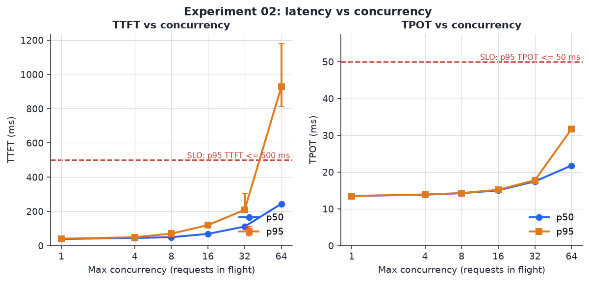

# vllm-inference-bench

How does an LLM inference server behave under load, and what does a token cost? This repo benchmarks `Qwen/Qwen2.5-1.5B-Instruct` served by **vLLM 0.34.0** on an **NVIDIA L4**, changing one engine setting at a time. It reports latency (TTFT, TPOT, ITL, E2E), throughput, KV-cache behaviour and **$ per 1M output tokens under a latency SLO**.

Every number comes from real GPU runs: the median of 3 repeats, each in its own container (throughput CV ≤ 3.3%). The full analysis is in **[report.md](report.md)**.



## Key findings

- **Batch 1 is bandwidth-bound:** TPOT is 13.4 ms against a 10.3 ms floor (3.1 GB of weights / 300 GB/s), about 77% of the memory-bandwidth roofline.
- **Concurrency is the big lever:** going from 1 to 16 users raises throughput from 73 to 833 tok/s, with TPOT only 13.4 → 16.4 ms. Cost per 1M output tokens falls from $3.03 to $0.27.
- **Tail TTFT breaks first:** p95 TTFT crosses the 500 ms SLO between 16 and 32 users (427 → 809 ms). Prefill queueing drives it; the KV cache is under 7% used.
- **Chunked-prefill budget reshapes latency, not throughput:** an 8192-token budget gives the best p95 inter-token latency (27 ms) and the worst p99 (560 ms).
- **Prefix caching:** −70% TTFT and +54% throughput on a shared-prefix workload. The hit rate (0.89) matches the shared fraction of each prompt.
- **KV-cache exhaustion:** a 2 GiB cache under ~98k tokens of demand caused 70 preemptions, 2× p95 TTFT and −12% throughput, as predicted from the per-token KV size.
- **Best under SLO:** concurrency 16, **$0.27 / 1M output tokens** on an L4 ($0.22 with prefix caching on shared-prefix traffic).
- **Caught a benchmark bug:** a shared random seed let prefix caching inflate early results (about 2× too cheap). Repeated runs plus cache-hit telemetry exposed it, and per-workload seeds fixed it. See [report.md § Lesson](report.md#lesson-my-benchmark-was-fooled-by-prefix-caching).

## Experiments

Every variant config differs from `baseline` in exactly one flag. Each (experiment, config) pair gets a fresh server in a fresh container.

| ID | Question | What varies | Workload |
|----|----------|-------------|----------|
| 01 | Single-user latency profile | — | concurrency 1 |
| 02 | Throughput vs latency | concurrency 1 → 64 | 512 in / 128 out |
| 03 | Prefill vs decode cost | input {128, 1024, 4096} × output {64, 512} | concurrency 8 |
| 04a | Batch width | `--max-num-seqs` 8 / 32 / 256 | concurrency 64 |
| 04b | Chunked-prefill budget | `--max-num-batched-tokens` 512 / 2048 / 8192 | 4096-token prompts, concurrency 16 |
| 04c | Prefix caching | on vs off | shared 1024-token prefix + 128-token suffix |
| 04d | KV-cache capacity | `--kv-cache-memory-bytes` 2 GiB vs default | ~98k tokens of demand |
| 05 | Cheapest config that meets the SLO | analysis | 02 + 04 |

- **Workload:** random-token prompts with a seed per workload, `--ignore-eos` (exact output length), `--temperature 0`, 10 warm-up requests.
- **SLO:** p95 TTFT ≤ 500 ms, p95 TPOT ≤ 50 ms, zero failed requests.
- **Cost:** `$/1M output tokens = gpu_$per_hr / (output_tok_per_s × 3600) × 1e6`, GPU time only, at Modal list prices.

## Architecture

GitHub Actions orchestrates; Modal provides the GPUs.

```
GitHub Actions (CPU runner)                  Modal (GPU container, one per config × repeat)
───────────────────────────                  ──────────────────────────────────────────────
workflow_dispatch                            run_config(job)
  └─ modal run benchmark/modal_app.py ─────►   1. vllm serve <config flags>
       fan out: run_config.map(jobs)           2. wait for /health
                                               3. vllm bench serve × N workloads
                                               4. sample nvidia-smi + /metrics every 0.5 s
  ◄──────── one JSON per workload ─────────    5. return results, stop server
analysis/analyze.py
  ├─ results/summary.csv, summary_agg.csv, SUMMARY.md ─► job summary
  ├─ plots/*.png
  └─ commit results/ and plots/
```

```
benchmark/   modal_app.py (image, volume, entrypoint)  server.py  workloads.py  telemetry.py  config.py
configs/     baseline.yaml + one-flag variants, experiments.yaml, slo.yaml, gpu_prices.yaml
analysis/    analyze.py (medians, spread, SLO, cost, plots), tests + fixtures (synthetic, tests only)
results/     raw/<run_id>/*.json, summary.csv, summary_agg.csv, SUMMARY.md
plots/       latency/throughput curves, per-setting comparisons, cost vs latency
report.md    engineering report
```

## Reproduce

1. Create a Modal token (modal.com → Settings → API Tokens). Add `MODAL_TOKEN_ID` and `MODAL_TOKEN_SECRET` as GitHub Actions secrets.
2. Actions → **benchmark** → Run workflow. The inputs are:
   - `experiments`: `all`, or a list like `01,02`
   - `gpu`: `L4`, `A10G`, `A100-40GB` or `H100`
   - `smoke`: a few-cents pipeline check
   - `repeats`: default 3

   A full L4 run costs about $3–5 of GPU time.

Or locally, with `pip install -r requirements.txt` and `modal setup`:

```bash
modal run benchmark/modal_app.py --smoke
modal run benchmark/modal_app.py --experiments all --gpu L4 --no-smoke --repeats 3
python analysis/analyze.py results/raw/<run_id>
```

Dev checks (no GPU or Modal account needed): `pip install -r requirements-dev.txt && ruff check . && pytest -q`

## How this was built

I defined the experiments, ran them and own the analysis. Claude (Anthropic) was used as a coding and writing assistant for the harness, configs, tests, workflows and drafting the report. Every benchmark number comes from real runs on Modal GPUs.

## License

MIT
