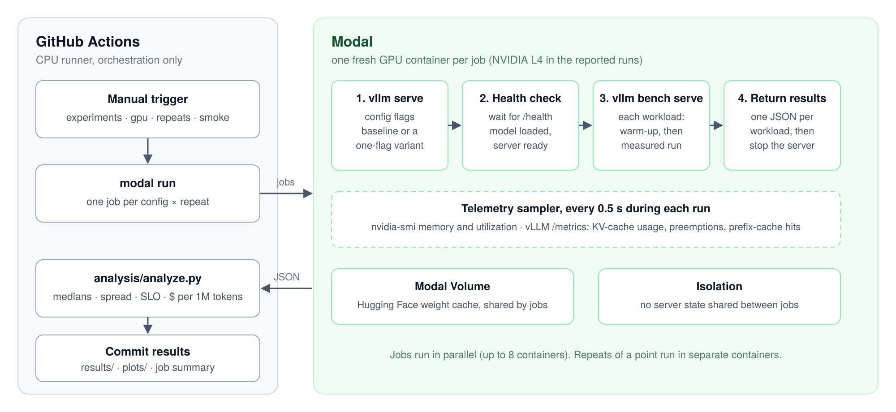

# vllm-inference-bench

A benchmark of LLM inference serving with **vLLM 0.34.0** on an **NVIDIA L4**, using `Qwen/Qwen2.5-1.5B-Instruct`. It varies one engine setting at a time and reports latency (TTFT, TPOT, inter-token latency, end-to-end), throughput, KV-cache behaviour, and cost per 1M output tokens under a latency SLO.

All figures are medians of 3 repeats, each run in a separate container (throughput CV ≤ 3.3%). The full analysis is in **[report.md](report.md)**.


## Key findings

- **Single-user decode is memory-bandwidth-bound.** TPOT is 13.4 ms against a 10.3 ms floor (3.1 GB of weights at 300 GB/s), about 77% of the roofline.
- **Concurrency drives cost.** From 1 to 16 concurrent users, throughput rises from 73 to 833 tok/s while TPOT goes from 13.4 to 16.4 ms. Cost falls from $3.03 to $0.27 per 1M output tokens.
- **Tail TTFT is the first limit.** p95 TTFT crosses the 500 ms SLO between 16 and 32 users (427 to 809 ms), caused by prefill queueing. KV-cache usage stays below 7%.
- **The chunked-prefill budget changes latency shape, not throughput.** A budget of 8192 tokens gives the best p95 inter-token latency (27 ms) and the worst p99 (560 ms).
- **Prefix caching** cuts TTFT by 70% and raises throughput by 54% on a shared-prefix workload. The hit rate (0.89) equals the shared fraction of each prompt.
- **KV-cache exhaustion** was forced with a 2 GiB cache against ~98k tokens of demand: 70 preemptions, 2× p95 TTFT, 12% lower throughput.
- **Best configuration under the SLO:** concurrency 16 at **$0.27 per 1M output tokens** on an L4 ($0.22 with prefix caching on shared-prefix traffic).
- **Methodology correction.** A shared random seed let prefix caching inflate early results (cost about 2× too low). Repeated runs and cache-hit telemetry exposed it; per-workload seeds fixed it. See the [methodology note](report.md#methodology-note-prefix-cache-contamination-in-the-first-run).

## Experiments

Each variant differs from the `baseline` config in exactly one flag. Each (experiment, config) pair runs on a fresh server in a fresh container.

| ID | Question | Variable | Workload |
|----|----------|----------|----------|
| 01 | Single-user latency | none | concurrency 1 |
| 02 | Throughput vs latency | concurrency 1 to 64 | 512 in / 128 out |
| 03 | Prefill vs decode cost | input {128, 1024, 4096} × output {64, 512} | concurrency 8 |
| 04a | Batch width | `--max-num-seqs` 8 / 32 / 256 | concurrency 64 |
| 04b | Chunked-prefill budget | `--max-num-batched-tokens` 512 / 2048 / 8192 | 4096-token prompts, concurrency 16 |
| 04c | Prefix caching | on / off | shared 1024-token prefix, 128-token suffix |
| 04d | KV-cache capacity | `--kv-cache-memory-bytes` 2 GiB / default | ~98k tokens of demand |
| 05 | Lowest cost within the SLO | analysis only | uses 02 and 04 |

- **Workload:** random-token prompts with a distinct seed per workload, `--ignore-eos` (fixed output length), `--temperature 0`, 10 warm-up requests.
- **SLO:** p95 TTFT ≤ 500 ms, p95 TPOT ≤ 50 ms, no failed requests.
- **Cost:** `$/1M output tokens = gpu_price_per_hour / (output_tok_per_s × 3600) × 1e6`. GPU time only, at Modal list prices.

## Architecture

GitHub Actions orchestrates the run and Modal supplies the GPUs.



```
benchmark/   Modal app, server lifecycle, workload commands, telemetry sampler, config loader
configs/     baseline and one-flag variants, experiment matrix, SLO, GPU prices
analysis/    aggregation (medians, spread, SLO, cost), plots, tests with synthetic fixtures
results/     raw JSON per run, summary.csv, summary_agg.csv, SUMMARY.md
plots/       latency and throughput curves, per-setting comparisons, cost vs latency
docs/        architecture diagram (SVG source and PNG)
report.md    engineering report
```

## Reproducing the results

1. Create a Modal API token (modal.com, Settings, API Tokens) and add `MODAL_TOKEN_ID` and `MODAL_TOKEN_SECRET` as GitHub Actions secrets.
2. Run the **benchmark** workflow (Actions tab). Inputs:
   - `experiments`: `all`, or a list such as `01,02`
   - `gpu`: `L4`, `A10G`, `A100-40GB` or `H100`
   - `smoke`: a low-cost pipeline check (about $0.10)
   - `repeats`: repeats per point (default 3)

   A full L4 run costs roughly $3 to $5 of GPU time.

To run locally instead, install `requirements.txt`, run `modal setup`, then:

```bash
modal run benchmark/modal_app.py --smoke
modal run benchmark/modal_app.py --experiments all --gpu L4 --no-smoke --repeats 3
python analysis/analyze.py results/raw/<run_id>
```

Development checks need no GPU or Modal account: `pip install -r requirements-dev.txt && ruff check . && pytest -q`

See [results/README.md](results/README.md) for which runs feed the committed summary.

## Authorship

I designed the experiments, ran them and wrote the analysis. Claude (Anthropic) assisted with the code, tests, workflows and drafting of the report. All reported figures are measured on Modal GPUs.

## License

MIT
